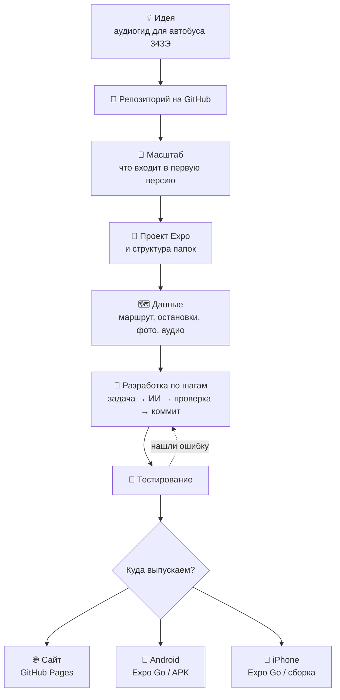
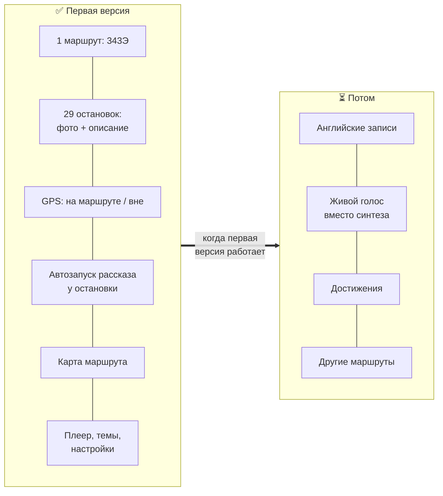
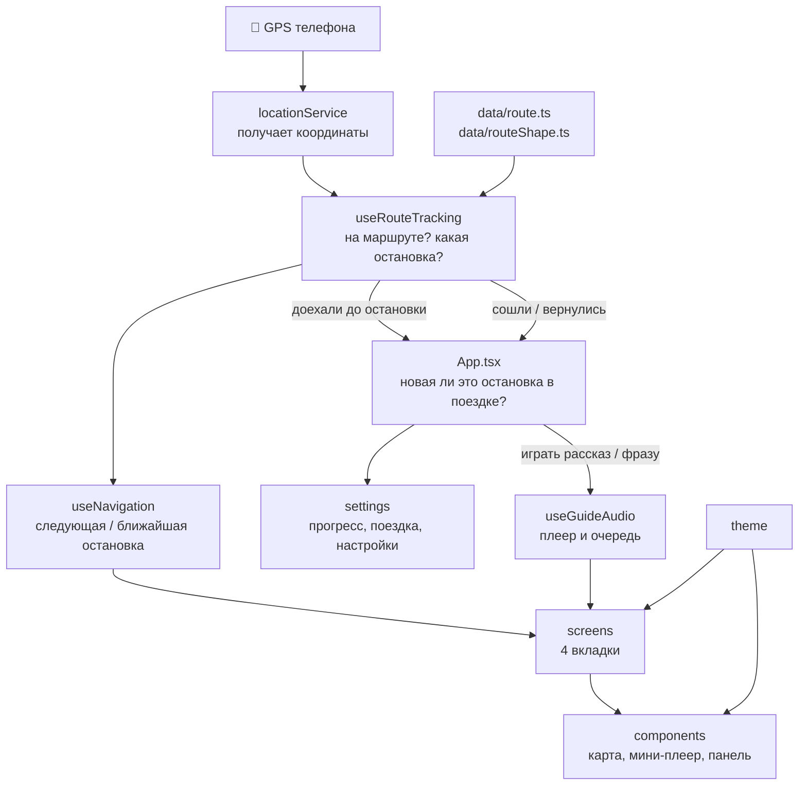
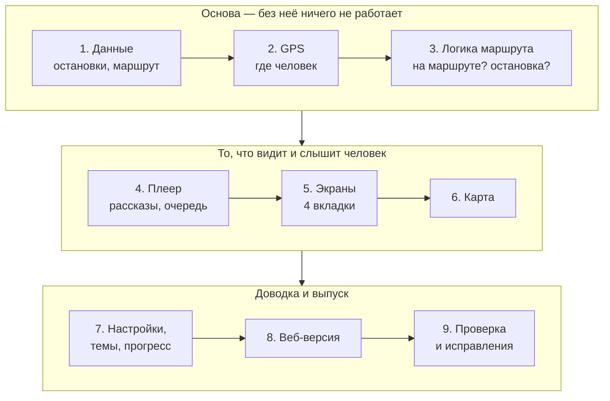
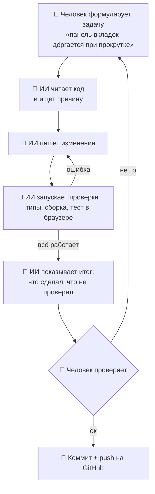
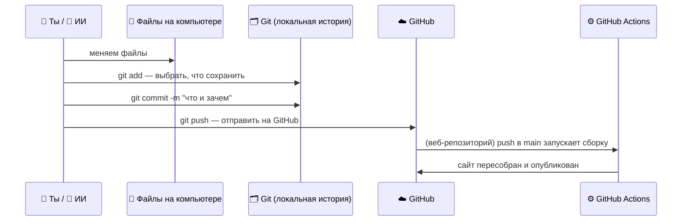
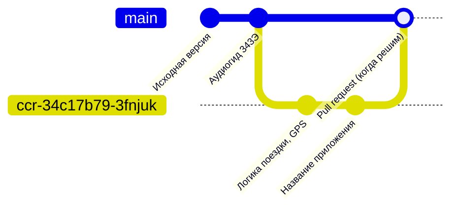
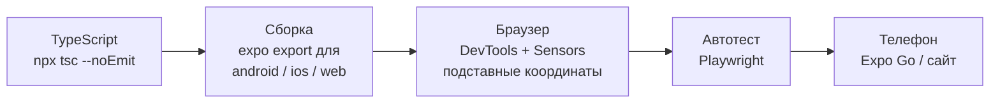
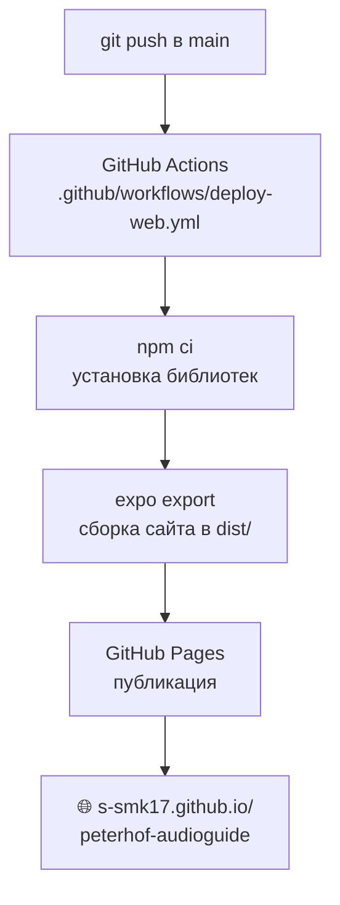
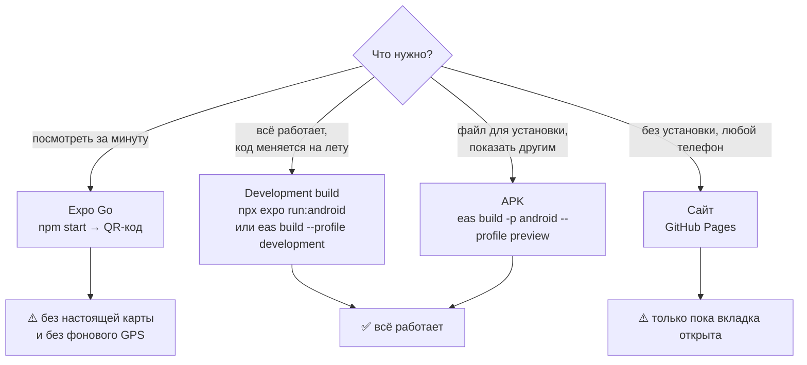

# Как мы разрабатывали аудиогид с нейросетью

> Пошаговый план на примере проекта **«Аудиогид Петергоф · маршрут 343Э»**.
> Подходит, чтобы объяснить процесс преподавателю или школьникам.
> Схемы нарисованы на Mermaid — Obsidian и GitHub показывают их как картинки.

**Что за приложение.** Аудиогид для автобуса 343Э (Ломоносов → Петергоф →
метро «Проспект Ветеранов»). Телефон следит за GPS и сам включает рассказ,
когда автобус подъезжает к одной из 29 остановок. Есть карта, фото, плеер,
светлая и тёмная темы. Одна и та же программа работает на **Android**,
**iPhone** и как **сайт**.

**Чем делали.** Expo (React Native) + TypeScript. Код писали вместе с
ИИ-агентом **Claude Code**: человек ставит задачи и проверяет результат,
нейросеть читает проект, пишет код, запускает проверки и делает коммиты.

---

## Оглавление

1. [Общая схема](#1-общая-схема)
2. [Инструменты](#2-инструменты)
3. [Репозиторий на GitHub](#3-репозиторий-на-github)
4. [Масштаб приложения](#4-масштаб-приложения)
5. [Создание проекта](#5-создание-проекта)
6. [Структура папок: что за что отвечает](#6-структура-папок-что-за-что-отвечает)
7. [Порядок разработки функций](#7-порядок-разработки-функций)
8. [Как работать с нейросетью](#8-как-работать-с-нейросетью)
9. [Коммиты: что это и как их делать](#9-коммиты-что-это-и-как-их-делать)
10. [История наших коммитов](#10-история-наших-коммитов)
11. [Проверка и тестирование](#11-проверка-и-тестирование)
12. [Веб-версия и публикация сайта](#12-веб-версия-и-публикация-сайта)
13. [Запуск на телефоне: Android и iPhone](#13-запуск-на-телефоне-android-и-iphone)
14. [Ошибки, которые мы встретили, и уроки](#14-ошибки-которые-мы-встретили-и-уроки)
15. [Как объяснить школьникам](#15-как-объяснить-школьникам)
16. [Шпаргалка команд](#16-шпаргалка-команд)

---

## 1. Общая схема



Главная идея: **не всё сразу, а маленькими шагами**. Каждый шаг — одна
понятная задача, её проверка и коммит (сохранение в истории).

---

## 2. Инструменты

| Инструмент | Зачем нужен |
| --- | --- |
| **GitHub** | хранит код и всю историю изменений, публикует сайт |
| **Git** | программа, которая записывает изменения (коммиты) |
| **Node.js** | запускает инструменты разработки (`npm`, `npx`) |
| **Expo** | один код → Android, iPhone и сайт |
| **TypeScript** | JavaScript с проверкой типов: ловит ошибки до запуска |
| **Claude Code** | ИИ-агент: читает проект, пишет код, запускает проверки, делает коммиты |
| **Expo Go** | приложение на телефоне для быстрого просмотра |
| **EAS** | облачная сборка установочных файлов для телефона |

---

## 3. Репозиторий на GitHub

**Репозиторий** — папка проекта, в которой Git помнит каждое изменение.
GitHub хранит её копию в интернете.

1. github.com → **New repository**.
2. Имя: `peterhof-audioguide` (латиницей, через дефис).
3. **Private** — код видите только вы; **Public** — видят все (нужно,
   например, для бесплатного GitHub Pages).
4. Добавить `README.md`, лицензию и `.gitignore` для Node.
   (В нашем проекте `LICENSE` достался от шаблона Expo — с копирайтом
   Expo. Для своего проекта его стоит заменить на свою лицензию.)
5. Скачать на компьютер:
   ```bash
   git clone https://github.com/<логин>/peterhof-audioguide.git
   ```
6. Подключить ИИ-агента к репозиторию (в Claude Code — через GitHub),
   чтобы он мог читать код и отправлять изменения.

Репозиторий один — `peterhof-audioguide`: из него собираются и приложение
для телефона, и сайт. Сначала веб-версию делали в отдельном репозитории
`peterhof-audioguide-web`, 27.10.2026 её объединили с основным.

---

## 4. Масштаб приложения

Перед кодом решаем, **что войдёт в первую версию (MVP)**, а что — потом.
Без этого проект расползается и не доделывается.



Вопросы, которые задаём себе:

- **Для кого?** Пассажир автобуса, телефон в руке или в кармане.
- **Главная функция?** Рассказ включается сам у остановки.
- **На каких устройствах?** Android, iPhone, потом сайт.
- **Где брать данные?** Маршрут — OpenStreetMap, фото — Wikimedia Commons
  (свободные лицензии, авторы указаны), аудио — пока синтез речи.

> Урок из проекта: в коде лежали пустые файлы «на потом» (`achievements`,
> `AchievementsScreen`, `ProgressBar`…). Они только путали, и при проверке
> мы их удалили. Делайте файл, когда начинаете функцию, а не заранее.

---

## 5. Создание проекта

```bash
npx create-expo-app@latest peterhof-audioguide --template blank-typescript
cd peterhof-audioguide
npm start
```

Что появляется сразу:

| Файл | Зачем |
| --- | --- |
| `package.json` | список библиотек и команд (`npm start`, `npm run web`) |
| `app.json` | настройки приложения: название, иконки, разрешения |
| `App.tsx` | главный компонент — с него всё начинается |
| `index.ts` | точка входа: запускает `App` |
| `tsconfig.json` | настройки TypeScript |

Отдельно — файлы **для нейросети**:

| Файл | Зачем |
| --- | --- |
| `AGENTS.md` / `CLAUDE.md` | инструкции для ИИ: «читай документацию Expo SDK 57 перед кодом». Агент читает их в начале каждой сессии |
| `.claude/settings.json` | настройки Claude Code для проекта (у нас подключён плагин Expo) |

---

## 6. Структура папок: что за что отвечает

```
peterhof-audioguide/
├── App.tsx                 ← сборка всего: вкладки, GPS + плеер, прогресс
├── index.ts                ← точка входа
├── app.json                ← название, иконки, разрешения (GPS, фон)
├── eas.json                ← профили сборки для телефона (EAS)
├── assets/
│   ├── audio/              ← 29 рассказов + «вы не на маршруте» / «снова на маршруте»
│   └── images/stops/       ← 29 фото остановок
└── src/
    ├── data/               ← ДАННЫЕ: остановки и линия маршрута
    ├── location/           ← GPS: где человек, на маршруте ли, какая остановка
    ├── audio/              ← ПЛЕЕР: очередь рассказов, автозапуск
    ├── screens/            ← ЭКРАНЫ: 4 вкладки
    ├── components/         ← ДЕТАЛИ: карта, мини-плеер, нижняя панель
    ├── settings/           ← НАСТРОЙКИ и сохранение прогресса
    ├── theme/              ← ЦВЕТА: светлая и тёмная темы
    └── utils/              ← мелкие помощники (формат времени, метров)
```

### Подробно по файлам

| Папка | Файл | За что отвечает |
| --- | --- | --- |
| `data` | `route.ts` | 29 остановок: название, описание, координаты, фото, аудио, автор фото |
| | `routeShape.ts` | линия маршрута автобуса (115 точек из OpenStreetMap) |
| `location` | `locationService.ts` | включает GPS, в том числе в фоне (экран выключен) |
| | `useRouteTracking.ts` | «мозг»: на маршруте ли человек, куда едет, какая остановка рядом |
| | `routeGeometry.ts` | математика: расстояние до линии, положение вдоль маршрута |
| | `useNavigation.ts` | следующая остановка или ближайшая, если сошли с маршрута |
| | `useWalkingRoute.ts` | пеший путь до остановки (сервер OpenStreetMap) |
| | `externalMaps.ts` | кнопки «Яндекс Карты» и «2ГИС» |
| `audio` | `useGuideAudio.ts` | плеер: запуск, пауза, перемотка, очередь, служебные фразы |
| `screens` | `HomeScreen.tsx` | «Главная»: статус GPS, карта, следующая остановка, прогресс |
| | `GuideScreen.tsx` | «Гид»: большой плеер, обложка, описание места |
| | `StopsScreen.tsx` | «Маршрут»: список всех 29 остановок |
| | `SettingsScreen.tsx` | «Ещё»: тема, автозапуск, скорость, GPS, сброс прогресса |
| `components` | `MapView.tsx` / `RouteMap.tsx` | карта MapLibre (в Expo Go — упрощённая `SchematicMap.tsx`) |
| | `FullscreenMap.tsx` | карта на весь экран + пеший маршрут |
| | `BottomNav.tsx` | нижняя панель с 4 вкладками |
| | `MiniPlayer.tsx` | маленький плеер над панелью |
| | `NavigationInfo.tsx` | «Следующая остановка · 510 м» |
| | `ui.tsx` | общие кирпичики: стеклянная карточка, иконки, переключатели |
| `settings` | `index.tsx` | настройки, прогресс и текущая поездка (сохраняются в памяти телефона) |
| `theme` | `index.ts` | палитры цветов и выбор темы |

### Как части связаны между собой



**Простыми словами:** GPS даёт координаты → «мозг» решает, у какой мы
остановки → `App` решает, включать ли рассказ → плеер играет → экраны
показывают.

### Файлы `.web` — для сайта

В репозитории веб-версии рядом с некоторыми файлами лежат двойники
с `.web` в имени. При сборке сайта берутся они, при сборке для
телефона — обычные. Остальной код общий.

| Для телефона | Для сайта | Почему отдельно |
| --- | --- | --- |
| `RouteMap.tsx` | `RouteMap.web.tsx` | нативная карта не работает в браузере |
| `locationService.ts` | `locationService.web.ts` | в браузере нет фонового GPS |
| `useGuideAudio.ts` | `useGuideAudio.web.ts` | браузер не даёт включать звук без касания |
| `externalMaps.ts` | `externalMaps.web.ts` | вместо приложений карт — их сайты |

Ещё только для сайта: `public/` (страница, иконки, манифест),
`app.config.js` (адрес сайта на GitHub Pages), `scripts/` (копирование
файла карты), `.github/workflows/` (автопубликация).

---

## 7. Порядок разработки функций

Строим снизу вверх: сначала то, от чего зависят остальные.



Почему так: экран без данных показать нечего, плеер без GPS не знает,
когда играть. Каждый шаг можно проверить отдельно.

---

## 8. Как работать с нейросетью

### Цикл одной задачи



### Как формулировать задачу

| ❌ Плохо | ✅ Хорошо |
| --- | --- |
| «Сделай сайт» | «Сделай веб-версию из этого же Expo-проекта, не трогая основной репозиторий» |
| «Почини» | «Нижняя панель вкладок дёргается и не стоит на месте, когда прокручиваю экран на телефоне» |
| «Сделай красиво» | «На компьютере интерфейс растянут на весь экран — ограничь ширину, как у телефона» |
| «Проверь» | «Прогони репозиторий на все возможные ошибки и исправь то, в чём уверен» |

### Правила

1. **Одна задача за раз.** Маленькие шаги легче проверить и откатить.
2. **Объясняй, что видишь, а не как чинить.** ИИ найдёт причину сам —
   так он нашёл, что карта схлопывалась из-за CSS.
3. **Требуй проверку.** «Запусти и покажи» лучше, чем «должно работать».
   Половину ошибок проекта нашли только при запуске.
4. **Говори, что трогать нельзя.** Мы попросили не менять основной
   репозиторий — ИИ создал ветку и отдельный репозиторий для сайта.
5. **Читай итог.** В конце ИИ пишет, что не проверил (например, «на
   настоящем iPhone не запускал»). Это нужно проверить самому.
6. **Инструкции для ИИ — в `AGENTS.md`.** Правила проекта, которые он
   читает в каждой сессии.

---

## 9. Коммиты: что это и как их делать

**Коммит** — сохранённый снимок проекта с подписью «что изменилось».
Как сохранение в игре: можно вернуться к любому.

### Как проходит коммит



### Команды

```bash
git status                     # что изменилось
git diff                       # сами изменения построчно
git add src/screens/HomeScreen.tsx   # добавить файл (или: git add -A — всё)
git commit -m "Главная: карта не растягивается на компьютере"
git push                       # отправить на GitHub
git log --oneline              # история
```

### Как пишем сообщение коммита

```
Сайт: неподвижная панель вкладок, плавная прокрутка   ← заголовок: ЧТО (до ~70 знаков)
                                                       ← пустая строка
- Страница целиком больше не «пружинит» на iPhone…    ← тело: ЗАЧЕМ и подробности
- Размытие фона только у плавающих панелей…

Co-Authored-By: Claude Opus 5.5 <noreply@anthropic.com>   ← отметка, что писал ИИ
```

Правила:

- **Один коммит — одна мысль.** Не смешивать «новая функция» и «починил
  опечатку».
- **Сначала проверка, потом коммит.** Сломанный код в истории мешает всем.
- **Не коммитить мусор:** `node_modules/`, `dist/`, скриншоты тестов. Для
  этого есть `.gitignore`. (Мы дважды случайно закоммитили скриншот теста
  и удаляли его отдельным коммитом — хороший пример, зачем `.gitignore`.)

### Ветки и pull request



- **`main`** — главная, «чистовая» версия.
- **Ветка** — черновик рядом с `main`. ИИ кладёт изменения в ветку, чтобы
  не трогать рабочую версию без спроса.
- **Pull request** — запрос «влей мою ветку в main». На GitHub видно все
  изменения, их можно обсудить и принять кнопкой **Merge**.

В основном репозитории правки лежат в ветке `ccr-34c17b79-3fnjuk` — их
вливаем через pull request. В веб-репозитории ИИ пушил прямо в `main`,
потому что этот репозиторий создан под веб-версию.

---

## 10. История наших коммитов

### Основное приложение (`peterhof-audioguide`)

| № | Коммит | Что сделано |
| --- | --- | --- |
| 1 | `21ef732` Исходная версия проекта | шаблон Expo, `App.tsx`, конфиги, иконки, `AGENTS.md` |
| 2 | `95a82a0` Аудиогид 343Э: GPS-маршрут, карта, плеер… | вся основная функциональность: 29 остановок, аудио, GPS и фоновая геолокация, карта, плеер, темы, фото |
| 3 | `4912a62` Логика поездки, GPS и чистка кода | *(в ветке)* повторные поездки, правильные голосовые подсказки, защита от скачков GPS, удалён лишний код |
| 4 | `52ed6b8` Название «Аудиогид Петергоф» | *(в ветке)* имя на экране телефона, русский запрос геолокации на iOS |

### Веб-версия (бывший `peterhof-audioguide-web`, объединён с основным)

Начинается с тех же коммитов 1–2, дальше:

| № | Коммит | Что сделано |
| --- | --- | --- |
| 3 | `f4d0d00` Веб-версия аудиогида | файлы `.web`, карта для браузера, PWA, автопубликация на GitHub Pages |
| 4 | `a86ae87` README | инструкции: запуск, телефон, публикация, тестирование |
| 5 | `f6ce438` Исправления по итогам проверки | ширина на компьютере, лишний мини-плеер, запасная карта, если сервер карт недоступен, название |
| 6 | `8ff52ab` Убрать скриншот | удалён случайно попавший файл |
| 7 | `a026654` Логика поездки, GPS и чистка кода | то же, что №3 в основном приложении |
| 8 | `64cb2e9` Неподвижная панель вкладок | панель не «пружинит», прокрутка плавная, новая версия карты |
| 9 | `db53a4b` Не хранить скриншот автотеста | `.gitignore` |

Как это выглядело на деле: человек писал задачу в чат,
ИИ делал изменения, проверял и сам выполнял `git commit` и `git push`.
Автор коммитов из сессии — `Claude`, в конце сообщения отметка
`Co-Authored-By`.

---

## 11. Проверка и тестирование



| Уровень | Что ловит | Как |
| --- | --- | --- |
| Типы | опечатки, неверные данные | `npx tsc --noEmit` |
| Сборка | сломанные импорты, конфиг | `npx expo export --platform web` (и `android`, `ios`) |
| Браузер вручную | экраны, кнопки, логика GPS | `npm run web`, DevTools → Sensors → координаты остановок |
| Автотест | «проехать маршрут» без человека | скрипт на Playwright (пример в README) |
| Телефон | реальный GPS, звук, жесты | Expo Go или сайт по HTTPS |

Подробный чек-лист и координаты для теста — в `README.md`.

---

## 12. Веб-версия и публикация сайта



Один раз настроить: репозиторий публичный, Settings → Pages → Source:
**GitHub Actions**. Дальше каждый push в `main` сам обновляет сайт.

Сайт можно «установить» на телефон: Safari → Поделиться → «На экран
Домой», Chrome → меню → «Добавить на главный экран».

---

## 13. Запуск на телефоне: Android и iPhone



### Android

1. **Expo Go:** установить из Google Play → `npm start` → отсканировать QR.
2. **APK:** `npm install -g eas-cli` → `eas login` →
   `eas build -p android --profile preview` → ссылка на файл → установить
   (разрешить «из неизвестных источников»).

### iPhone

1. **Expo Go:** установить из App Store → `npm start` → QR камерой.
2. **Своя сборка:** нужен платный аккаунт Apple Developer →
   `eas device:create` → `eas build -p ios --profile preview`.
3. **Без аккаунта Apple** удобнее сайт.

Почему Expo Go ограничен: в нём нет «нативных модулей» нашего проекта —
карты MapLibre и фоновой геолокации. Приложение это видит и показывает
упрощённую схему вместо карты.

---

## 14. Ошибки, которые мы встретили, и уроки

| Что случилось | Причина | Урок |
| --- | --- | --- |
| Сайт — белый экран | нативная карта не работает в браузере | у сайта и телефона разные возможности → файлы `.web` |
| Карта нулевой высоты | CSS библиотеки перебил стили | проверять в настоящем браузере, а не только читать код |
| Звук не включался сам | браузеры запрещают звук без касания | учитывать правила платформы |
| Пустая карта без линии маршрута | сервер карт не ответил | делать запасной вариант |
| Остановка в 600 м от маршрута | скачок GPS | не доверять одной отметке GPS |
| Пройденные остановки молчали всегда | прогресс и автозапуск были одним списком | разделять «статистику» и «текущую поездку» |
| «Вы не на маршруте» при запуске дома | подсказка звучала при первой же отметке | думать, как человек реально пользуется |
| Панель вкладок «пружинила» | на iPhone двигалась вся страница | тестировать на телефоне |
| Скриншот теста попал в коммит | `git add -A` берёт всё | `.gitignore` и `git status` перед коммитом |

Главный урок: **ИИ пишет быстро, но проверка — обязательна.** Почти все
ошибки нашлись только при запуске.

---

## 15. Как объяснить школьникам

| Понятие | Аналогия |
| --- | --- |
| Репозиторий | тетрадь проекта, которая помнит каждое исправление |
| Коммит | сохранение в игре с подписью, что изменилось |
| Push | отправить сохранение в облако |
| Ветка | черновик рядом с чистовиком |
| Pull request | «учитель, проверь мой черновик и перенеси в чистовик» |
| Папки `src/` | отделы в компании: данные, GPS, звук, экраны |
| ИИ-агент | очень быстрый стажёр: много умеет, но работу надо проверять |
| MVP | сначала велосипед, потом мотоцикл — а не наоборот |
| Тест | контрольная для программы |

**Сценарий урока (45 минут):**

1. *(5 мин)* Показать приложение и сайт на телефоне.
2. *(10 мин)* Общая схема и папки — «кто за что отвечает».
3. *(15 мин)* Живой цикл с ИИ: маленькая задача (например, поменять
   текст на кнопке) → ИИ меняет → проверяем → коммит.
4. *(10 мин)* Показать историю коммитов на GitHub и одну ошибку из
   таблицы выше: как её нашли и исправили.
5. *(5 мин)* Вопросы.

---

## 16. Шпаргалка команд

```bash
# Проект
npm install                 # установить библиотеки
npm start                   # запуск: QR-код для Expo Go
npm run web                 # открыть в браузере
npm run build:web           # собрать сайт в dist/ (веб-репозиторий)

# Проверки
npx tsc --noEmit            # проверка типов
npx expo export --platform android   # контрольная сборка

# Git
git status                  # что изменилось
git add -A                  # добавить всё
git commit -m "сообщение"   # сохранить снимок
git push                    # отправить на GitHub
git log --oneline           # история
git switch -c моя-ветка     # создать ветку

# Телефон (EAS)
npm install -g eas-cli
eas login
eas build -p android --profile preview      # APK
eas build -p android --profile development  # development build
```

> Команды EAS — для Expo SDK 57. Перед работой сверяйтесь с документацией:
> https://docs.expo.dev/versions/v57.0.0/
