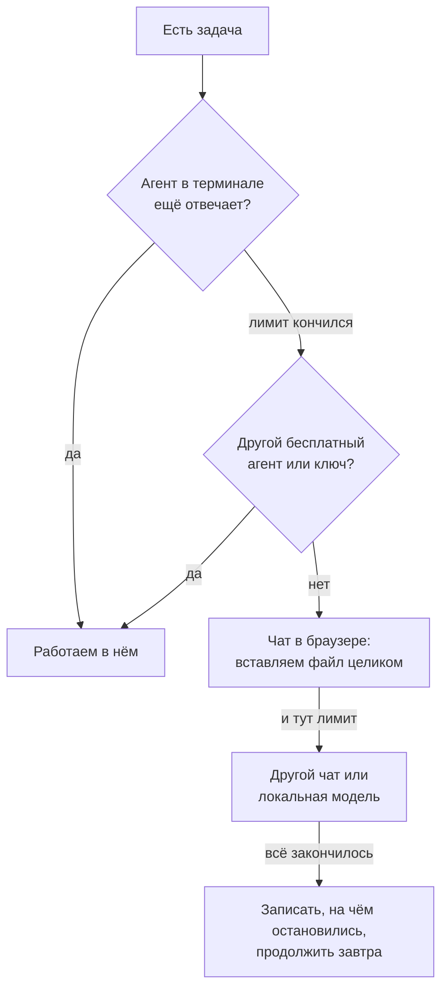

# Пошаговый план: что делать, в каком файле и что сказать нейросети

> Это подробная инструкция к [плану разработки](development-plan.md): тот
> рассказывает **как устроен процесс**, а здесь — **что именно делать на
> каждом шаге**, вплоть до файла и текста запроса.
> Рассчитано на **бесплатные нейросети**: они слабее платных, быстрее
> упираются в лимиты и хуже помнят длинный разговор — поэтому шаги мелкие.

---

## Часть A. Работа с бесплатными нейросетями

### A1. Какие бывают (проверяйте актуальность — условия меняются часто)

Названия, лимиты и доступность в вашей стране меняются. Перед началом
откройте сайт сервиса и посмотрите, что бесплатно сейчас. Часть сервисов
из России работает только с VPN — проверьте заранее, не посреди работы.

| Тип | Примеры | Как использовать | Минусы |
| --- | --- | --- | --- |
| **Чат в браузере** | Claude (бесплатный тариф), ChatGPT (бесплатный), Gemini, DeepSeek, Qwen, Le Chat (Mistral) | копируете код в чат, берёте ответ назад | всё вручную; чат не видит ваши файлы; лимит сообщений в день |
| **Агент в терминале** | Gemini CLI, Qwen Code, OpenCode, Aider | сам читает файлы, правит их, запускает проверки | у бесплатных тарифов дневной лимит запросов; слабые модели ошибаются в больших файлах |
| **Расширение для редактора** | Cline, Continue, Roo Code (в VS Code) + бесплатный ключ | работает как агент прямо в редакторе | нужен ключ от какого-нибудь сервиса; смотрите лимиты ключа |
| **Бесплатные модели через шлюз** | OpenRouter (модели с пометкой `:free`) | один ключ — много моделей | очереди, лимиты, модели иногда пропадают |
| **На своём компьютере** | Ollama, LM Studio (модели Qwen-Coder, DeepSeek-Coder, Llama) | без интернета и лимитов | нужна мощная видеокарта / много памяти; маленькие модели заметно глупее |

**Как выбрать.** Начните с агента в терминале (меньше ручной работы). Когда
дневной лимит кончился — переходите на чат в браузере, потом на другой
сервис. Не привязывайтесь к одной нейросети.



### A2. Что бесплатные модели делают плохо — и как с этим жить

| Проблема | Что делать |
| --- | --- |
| **Не знают новые версии.** Expo SDK 57 и Flet 1.0 вышли позже, чем обучены многие модели: они пишут код «по памяти» от старых версий | В начале каждого запроса вставляйте кусок документации (ссылки: [Expo](https://docs.expo.dev/versions/v57.0.0/), [Flet](https://flet.dev/docs/)) и просите: «используй только то, что есть в этом тексте». В проекте это закреплено в `typescript/AGENTS.md` и `python/AGENTS.md` |
| **Забывают начало длинного разговора** | Одна задача = один новый чат. Не продолжайте вчерашний чат — начните новый и вставьте контекст (A3) |
| **Придумывают несуществующие функции** | После каждого ответа — проверка: `npx tsc --noEmit` или `pytest`. Ошибку вставляйте обратно **целиком**, не пересказывайте |
| **Переписывают лишнее** | Пишите: «Измени только функцию X в файле Y. Остальное не трогай. Покажи только изменённые строки» |
| **Ломают соседние файлы** | Перед каждой задачей `git status` чистый; после — `git diff`: смотрите, что изменилось. Не нравится — `git restore <файл>` |
| **Путают две версии** | Давайте задачу сначала для одной версии, проверьте, потом: «сделай то же в Python, вот готовый TypeScript-код» |
| **Упираются в лимит посреди задачи** | Мелкие шаги + коммит после каждого: ничего не потеряется, можно продолжить в другой нейросети |

### A3. Контекст-шпаргалка (вставлять в начало нового чата)

Если у агента нет доступа к файлам (чат в браузере), вставляйте это
сообщение, подставив своё:

```
Мы делаем аудиогид для автобуса 343Э (Петергоф). Две версии одной программы:
typescript/ (Expo SDK 57, React Native, TypeScript) и python/ (Flet 1.0).
Правила:
1. Любая правка делается в обеих версиях (я скажу, с какой начинаем).
2. Не используй API «по памяти»: Expo SDK 57 и Flet 1.0 новее твоих знаний.
   Опирайся только на документацию, которую я вставил ниже.
3. Меняй только то, что я прошу. Не рефакторь, не переименовывай.
4. Отвечай коротко: какой файл, что заменить, готовый код.
Сейчас задача: <одна фраза>.
Файл, который нужно менять (целиком):
<вставить файл>
Документация по теме:
<вставить кусок>
```

### A4. Шаблон хорошего запроса (одна задача)

```
Цель: <что должен увидеть/получить человек, одной фразой>.
Где: файл <путь>.
Сейчас: <что происходит>.
Нужно: <что должно происходить>.
Не трогай: <что нельзя менять>.
Как проверю: <команда или действие в приложении>.
```

Пример (реальная задача из проекта):

```
Цель: на главном экране карта маленькая и не двигается; по нажатию открывается на весь экран.
Где: typescript/src/components/RouteMap.tsx и RouteMap.web.tsx.
Сейчас: карту можно двигать пальцем прямо на главном экране.
Нужно: на главном экране жесты выключены, нажатие в любом месте открывает карту на весь экран; в полноэкранном режиме двигать и увеличивать можно.
Не трогай: логику камеры и маркеры.
Как проверю: npx tsc --noEmit и npm run web.
```

### A5. Рабочий цикл на каждый шаг (одинаковый для всех этапов)

1. `git status` — всё чисто? Если нет — сначала коммит или `git restore`.
2. Новый чат (или новый запуск агента). Вставить контекст (A3) и запрос (A4).
3. Получить ответ. **Не принимать вслепую**: открыть `git diff`, прочитать.
4. Проверить командой (`npx tsc --noEmit`, `.venv/bin/python -m pytest`) и
   глазами (`npm run web`, `flet run --web src/main.py`).
5. Ошибка → вставить текст ошибки в тот же чат → шаг 3. Не вышло за 3 круга
   → `git restore .`, новый чат, переформулировать задачу или разбить на части.
6. Работает → `git add <файлы>` → `git commit -m "что сделано"` → `git push`.
7. Записать в `docs/development-plan.md` (история коммитов) — или попросить
   нейросеть это сделать: «добавь строку в таблицу истории коммитов».

---

## Часть B. Этапы: что, где и как проверить

Для каждого этапа: **цель → файлы → что делать по шагам → запрос → проверка →
коммит**. Этапы идут строго по порядку (см. [раздел 7 плана](development-plan.md#7-порядок-разработки-функций)).

### Этап 0. Подготовка компьютера

1. Установить [Git](https://git-scm.com/), [Node.js](https://nodejs.org/) (LTS),
   [Python 3.10+](https://www.python.org/), редактор (VS Code).
2. Проверить: `git --version`, `node --version`, `npm --version`, `python3 --version`.
3. Завести аккаунт на GitHub и 1–2 бесплатных нейросети (A1). Запасная нужна
   на случай лимита.
4. `git config --global user.name "Имя"` и `git config --global user.email "почта"`.

### Этап 1. Репозиторий

- **Цель:** пустая папка проекта, привязанная к GitHub.
- **Шаги:** создать репозиторий (раздел 3 плана) → `git clone …` → открыть
  папку в редакторе.
- **Файлы:** `README.md`, `LICENSE`, `.gitignore`.
- **Проверка:** `git status` пишет «nothing to commit».

### Этап 2. Файлы правил для нейросети

- **Цель:** чтобы любая нейросеть сразу знала правила проекта.
- **Файлы:** `AGENTS.md` (корень), `CLAUDE.md` (одна строка `@AGENTS.md`),
  `typescript/AGENTS.md`, `python/AGENTS.md`.
- **Что написать в корневом `AGENTS.md`:** структура папок; «правка в одной
  версии = правка в обеих»; «после правки обновить документацию».
- **Зачем:** агенты в терминале читают эти файлы сами. Для чата — вставляйте
  вручную (A3).
- **Коммит:** «Правила для ИИ».

### Этап 3. Проект на TypeScript

- **Команды:** `npx create-expo-app@latest typescript --template blank-typescript`,
  затем `cd typescript && npm start`.
- **Проверка:** QR-код в терминале; в Expo Go виден белый экран с текстом.
- **Файлы:** `App.tsx`, `index.ts`, `app.json`, `package.json`.
- **В `app.json` сразу:** `name` («Аудиогид Петергоф»), `slug`, `orientation`
  `portrait`, иконка.
- **Коммит:** «Заготовка Expo».

### Этап 4. Данные: остановки и маршрут

- **Цель:** 29 остановок и линия маршрута лежат в коде.
- **Файлы:** `typescript/src/data/route.ts`, `routeShape.ts`;
  фото — `typescript/assets/images/stops/`; звук — `typescript/assets/audio/`.
- **Откуда:** линия маршрута — OpenStreetMap (маршрут автобуса 343Э); фото —
  Wikimedia Commons (запишите автора и лицензию); тексты — свои, коротко;
  звук — синтез речи (бесплатные: системный голос, Silero, Piper).
- **Что делает нейросеть:** по вашему списку создаёт `route.ts`. **Координаты
  и тексты нейросети не выдумывать** — только ваши данные.
- **Запрос:** «Вот список остановок с координатами (вставить). Сделай файл
  `route.ts`: массив `routePoints`, тип `RoutePoint`. Не добавляй полей,
  которых нет в списке».
- **Проверка:** `npx tsc --noEmit`; число остановок равно 29.
- **Коммит:** «Данные: 29 остановок и линия маршрута».

### Этап 5. Логика маршрута (без экрана)

- **Цель:** функции, которые по координатам отвечают на вопрос «на маршруте
  ли человек и у какой он остановки».
- **Файлы:** `src/location/routeGeometry.ts` (расстояния),
  `useRouteTracking.ts` (состояние), `useNavigation.ts` (следующая остановка).
- **Правила:** ≤120 м от линии — «на маршруте»; >250 м — «сошёл»; одна
  отметка GPS ничего не решает (защита от скачков GPS).
- **Как делать:** функции по одной. Сначала `distanceMeters(a, b)`
  (формула гаверсинусов), проверить на двух известных точках; потом
  `distanceToRoute(point)`; потом остальное.
- **Запрос на каждую функцию:** «Напиши функцию `<имя>(<входы>) → <выход>`.
  Вот два примера: вход …, ответ … (ваши числа)».
- **Проверка:** тесты на Python (этап 12); на TypeScript — временный
  `console.log` с известными точками.
- **Коммит:** «Логика: расстояния, на маршруте / вне, следующая остановка».

### Этап 6. GPS

- **Файлы:** `src/location/locationService.ts` (+ `.web.ts` для сайта).
- **Что делать:** `npx expo install expo-location` → запросить разрешение →
  подписаться на `watchPositionAsync` → отдавать координаты в
  `useRouteTracking`. Фоновый режим: `expo-task-manager`.
- **В `app.json`:** тексты запроса разрешений **на русском**
  (`NSLocationWhenInUseUsageDescription` и т. д.), для Android —
  `ACCESS_FINE_LOCATION`, `ACCESS_BACKGROUND_LOCATION`.
- **Документация для нейросети:** страница `expo-location` версии SDK 57
  (вставьте целиком — модели часто путают старые имена функций).
- **Проверка:** на телефоне в Expo Go координаты меняются; в браузере —
  DevTools → Sensors → свои координаты.
- **Коммит:** «GPS: разрешения, фоновый режим».

### Этап 7. Плеер

- **Файлы:** `src/audio/useGuideAudio.ts` (+ `.web.ts`).
- **Что делает:** играет `mp3` остановки, пауза, перемотка, скорость, очередь
  (если подъехали к следующей остановке, пока играет предыдущая), служебные
  фразы «вы не на маршруте» / «снова на маршруте».
- **Нюансы:** на сайте звук разрешён только после первого касания — запуск
  сделать по кнопке.
- **Проверка:** кнопка «играть» на тестовом экране; очередь — вручную
  вызвать две остановки подряд.
- **Коммит:** «Плеер: очередь, перемотка, служебные фразы».

### Этап 8. Тема и «кирпичики» интерфейса

- **Файлы:** `src/theme/index.ts` (палитры), `src/components/ui.tsx`
  (стеклянная карточка, переключатель, иконки), `layout.ts` (ширина на
  компьютере ограничена, как у телефона).
- **Палитра:** «Петергоф: Балтика и золото» — тёмная и светлая; **контраст
  текста не ниже 4.5:1** (проверять на
  [webaim.org/resources/contrastchecker](https://webaim.org/resources/contrastchecker/)).
- **Запрос:** «Сделай `makeStyles((colors) => ({...}))` и хук `useTheme()`,
  палитры вот такие (вставить). Больше ничего».
- **Коммит:** «Тема и общие элементы».

### Этап 9. Экраны

Делать **по одному экрану, по одному коммиту**:

| Порядок | Файл | Что на экране |
| --- | --- | --- |
| 1 | `screens/StopsScreen.tsx` | «Маршрут»: список из 29 остановок, поиск по названию |
| 2 | `screens/GuideScreen.tsx` | «Гид»: обложка, плеер, описание, подпись автора фото |
| 3 | `screens/HomeScreen.tsx` | «Главная»: статус GPS, карта, следующая остановка, прогресс |
| 4 | `screens/SettingsScreen.tsx` | «Ещё»: тема, автозапуск, скорость, сброс прогресса, демо-поездка |
| 5 | `components/BottomNav.tsx`, `MiniPlayer.tsx` | нижняя панель из 4 вкладок, мини-плеер |
| 6 | `App.tsx` | собирает всё: вкладки + GPS + плеер + прогресс |

- **Запрос на экран:** «Сделай экран `<имя>` по описанию (список элементов
  сверху вниз). Используй `useTheme`, `Glass` из `ui.tsx`. Данные —
  `routePoints`. Без логики GPS».
- **Проверка:** `npm run web`, посмотреть в узком окне (как телефон) и в
  широком.

### Этап 10. Карта (подробно)

Самый хрупкий этап — здесь больше всего ошибок.

- **Файлы:**
  - `components/RouteMap.tsx` — нативная карта (`@maplibre/maplibre-react-native`);
  - `components/RouteMap.web.tsx` — карта для сайта (`maplibre-gl`);
  - `components/SchematicMap.tsx` — упрощённая схема для Expo Go (там нет
    нативного модуля карты; она не цветная — это схема без подложки);
  - `components/MapView.tsx` / `MapView.web.tsx` — выбирают нужную;
  - `components/FullscreenMap.tsx` — карта на весь экран + «Яндекс Карты» и «2ГИС»;
  - `theme/index.ts` — адрес стиля карты (`mapStyle`);
  - `scripts/copy-maplibre-worker.mjs` — копирует файл воркера карты для сайта.
- **Стиль карты — цветной:** `https://tiles.openfreemap.org/styles/liberty`
  (в обеих темах). Серые стили (`positron`, `dark`) не использовать — на них
  не видно парков, воды и зданий. Если сервер не ответил, рисуется запасной
  однотонный фон с линией маршрута.
- **Маленькая карта (главный экран):**
  1. жесты выключены: `dragPan`, `touchZoom`, `doubleTapZoom` = `false`
     (на сайте — `interactive: false`);
  2. поверх карты лежит прозрачная `Pressable` на всю площадь: нажатие в
     любом месте вызывает `onExpand` → открывается `FullscreenMap`;
  3. кнопка «⤢» остаётся как подсказка;
  4. камера сама следует за человеком (в пути), показывает человека и
     остановку (вне маршрута) или весь маршрут (без GPS).
- **Полноэкранная карта:** жесты включены (двигать, увеличивать); поворот
  выключен; если человек сдвинул карту — камера перестаёт следовать,
  появляется кнопка «⌖» «вернуться ко мне».
- **Слои (снизу вверх):** линия маршрута (широкая полупрозрачная + тонкая) →
  пеший маршрут (пунктир) → круги остановок (пройденные — зелёные) → маркер
  выделенной остановки с названием → маркер «я».
- **Запросы по шагам, не всё сразу:**
  1. «Покажи карту со стилем `<url>` и камерой по границам маршрута»;
  2. «Добавь линию маршрута из `ROUTE_SHAPE`»;
  3. «Добавь круги остановок»;
  4. «Добавь маркер человека»;
  5. «Добавь следование камеры»;
  6. «Отключи жесты, когда `fullscreen` = false, и добавь нажатие».
- **Проверка:** `npm run web`: маленькая карта цветная и не двигается;
  нажатие → полный экран, там двигается. На телефоне (не Expo Go) — то же.
- **Коммит на каждый подшаг.**

### Этап 11. Настройки и сохранение

- **Файлы:** `src/settings/index.tsx`.
- **Что хранится в памяти телефона:** тема, автозапуск, скорость, прогресс
  (какие остановки прослушаны), текущая поездка.
- **Важно:** «прогресс» (за всё время) и «текущая поездка» (чтобы не
  повторять рассказы) — **два разных списка**, иначе пройденные остановки
  молчат всегда (урок из раздела 15 плана).
- **Коммит:** «Настройки и прогресс».

### Этап 12. Версия на Python

Порядок тот же, что у TypeScript: **данные → логика → плеер → экраны**.

1. `cd python && python3 -m venv .venv`, затем
   `.venv/bin/pip install "flet[all]==1.0.5" flet-audio==1.0.5 flet-geolocator==1.0.5 flet-map==1.0.5 pytest`.
2. **Данные не писать руками:** сгенерировать `src/app/data/route.py` и
   `route_shape.py` из TypeScript.
3. **Логика один в один:** `geometry.py`, `tracking.py`, `controller.py` —
   те же пороги (120 / 250 м). Запрос: «Вот функция на TypeScript (вставить).
   Перепиши на Python, не меняя поведения. Вот тесты — они должны пройти».
4. **Тесты:** `tests/test_logic.py` — сначала тесты (по примерам из этапа 5),
   потом код.
5. **Экраны:** `screens/home.py`, `guide.py`, `stops.py`, `settings.py` —
   по одному.
6. **Карта:** `ui/route_map.py` — цветная подложка Esri World Street Map,
   жесты выключены (`InteractionFlag.NONE`), поверх прозрачный контейнер с
   `on_click` → полный экран (`ui/fullscreen_map.py`), там все жесты, кроме
   поворота.
7. **Документация Flet:** вставлять в запрос исходники из
   `.venv/lib/python*/site-packages/flet*` — нейросети плохо знают Flet 1.0.
- **Проверка:** `.venv/bin/python -m pytest` (зелёное) и
  `.venv/bin/flet run --web src/main.py`.

### Этап 13. Новые функции (по одной, в обеих версиях)

Каждая функция — отдельный цикл A5: сначала TypeScript, потом Python.

| Функция | Где | Как проверить |
| --- | --- | --- |
| Демо-поездка | `location/useDemoRide.ts` / `demo.py` | Ещё → «Прокатиться без автобуса» ×20 |
| «Куда смотреть» | `data/route.ts` (сторона) + плашка на «Гиде» | остановка с известной стороной показывает левое/правое окно |
| «Прослушано» | `App.tsx` / `controller.py` | рассказ дослушан на 80 % → остановка зелёная |
| Поиск остановки | `StopsScreen.tsx` / `stops.py` | набрать «дворец» — остаются подходящие |
| Новая палитра | `theme/index.ts` / `theme.py` | оба режима, контраст ≥ 4.5:1 |
| Цветная карта, жесты | этап 10 | см. этап 10 |

**Перед новой функцией спросите себя (и нейросеть):** нужна ли она
пассажиру автобуса? Лишнее (таймер сна, номера как в музее) — не делаем.

### Этап 14. Публикация

- **Файлы:** `.github/workflows/deploy-web.yml`, `build-python-apk.yml`.
- **Шаги:** Settings → Pages → Source → **GitHub Actions** → `git push` →
  вкладка Actions: зелёные галочки → сайты открываются.
- **Если сборка упала:** открыть красный запуск → скопировать последние
  ~40 строк лога → вставить нейросети: «сборка упала, вот лог, что менять?».
- **Коммит:** «Публикация: GitHub Pages и APK».

### Этап 15. Запуск на телефоне

См. [раздел 14 плана](development-plan.md#14-запуск-на-телефоне-android-и-iphone):
Expo Go / приложение Flet (QR), готовый APK из Releases или сайт.

### Этап 16. Финальная проверка перед показом

- [ ] `npx tsc --noEmit` — без ошибок; `.venv/bin/python -m pytest` — зелёное
- [ ] оба сайта открываются, карта цветная, на главном экране не двигается,
      по нажатию открывается на весь экран
- [ ] демо-поездка ×20 проезжает весь маршрут, рассказы включаются сами
- [ ] светлая и тёмная тема читаются
- [ ] `git status` чистый, `git push` выполнен
- [ ] в `docs/development-plan.md` внесён последний коммит

---

## Часть C. Если что-то пошло не так

| Симптом | Что делать |
| --- | --- |
| Нейросеть ходит по кругу, предлагает одно и то же | новый чат, разбить задачу пополам, добавить документацию |
| Исправила одно, сломала другое | `git diff` → `git restore <файл>` → повторить с «не трогай X» |
| Код не запускается, ошибка непонятна | вставить ошибку целиком + файл, где она; попросить «объясни простыми словами, потом исправь» |
| Лимит кончился | закоммитить рабочее → записать в плане, что осталось → другая нейросеть (A1) |
| Нет уверенности, что ответ верный | проверить командой, а не на слово; спросить другую нейросеть «найди ошибки в этом коде» |
